#  1Key

**화면 위에서 고양이를 키우는 비밀번호 단축키 프로그램.**
비밀번호·자주 쓰는 문장을 단축키 한 번으로 입력해 주는 Windows 11용 작은 도구인데, 작업 표시줄과 열어 둔 창 위를 오가며 고양이 한 마리가 같이 삽니다.
쓰다듬고 츄르를 주면 콩떡만 하던 고양이가 대왕식빵이 될 때까지 자라고 — **백업하고 비밀번호를 바꾸는 보안 습관도 고양이 밥이 됩니다.**

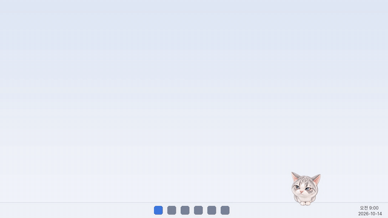

▶ [소개 영상(MP4, 1분 14초)](docs/video/1key-cat-intro.mp4)

## 🐱 고양이 키우기

### 작업 표시줄과 창 위를 오가는 고양이

설정에서 "트레이 위젯 모드"를 켜 두면 고양이가 나옵니다. 평소에는 작업 표시줄 위의 집 근처에 살고, 끌어다 놓으면 다른 창 위로도 올라갑니다. 1Key 창을 열어 두어도 그대로 있고, 누르면 1Key 창이 열립니다.

- **끌어서 옮기기**: 고양이를 끌어 원하는 자리에 놓으세요. 높은 곳에 놓으면 폴짝 떨어져 작업 표시줄에 착지하고, 그 자리를 새 집으로 삼아 그 근처를 다닙니다(다음에 켜도 그 자리).
- **창 위에 앉기**: 다른 창 위에 놓으면 떨어지다 그 창의 윗변에 앉아 창 폭 안에서 놉니다. 창을 옮기면 같이 가고, 창을 최소화 · 최대화하거나 닫거나 다른 창이 덮으면 아래로 내려옵니다. 다시 나올 때는 작업 표시줄의 집에서 나옵니다.
- **1Key 창과 겹쳐도** 고양이는 보입니다. 겹친 동안에는 고양이 아래의 1Key 단추 · 입력칸이 그대로 눌립니다(그동안 고양이는 누를 수 없어요).

- 집 근처의 작업 표시줄이나 앉아 있는 창 위를 걸어 다니다가 멈춰 앉아 **앞발 인사 · 야옹 · 그루밍 · 기지개 · 벌러덩 · 벽 기대기** 같은 동작을 합니다(작업 표시줄에서는 뒤로 숨었다 고개를 내미는 **빼꼼**도).
- 앉아 있는 동안에는 마우스 커서 쪽을 쳐다봅니다. 마우스를 올리면 이름과 하트가 보입니다.
- 매시 정각에는 화면 모서리에서 플립시계가 올라와 :59 → :00 으로 넘어가고, 고양이는 시계를 올려다봅니다.

<picture>
  <source media="(prefers-color-scheme: dark)" srcset="docs/images/cat/motions-dark.webp">
  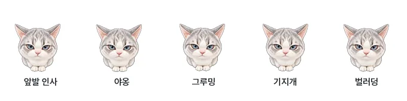
</picture>

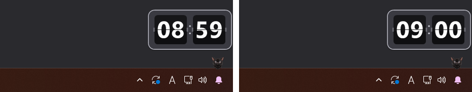

### 같이 놀기

고양이를 **오른쪽 클릭**하면 머리 위에 메뉴가 뜹니다. 쓰담 · 츄르 · 놀이를 하거나, 고양이 수첩 · 안내를 보고, 1Key 열기 · 잠금 · 설정 · 숨기기를 바로 할 수 있습니다.

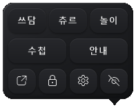

<picture>
  <source media="(prefers-color-scheme: dark)" srcset="docs/images/cat/play-dark.webp">
  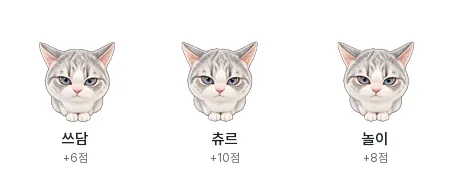
</picture>

- 놀아 주면 하트가 떠오르고 점수가 쌓입니다(쓰담 +6 · 츄르 +10 · 놀이 +8). 같은 놀이는 3분에 한 번 점수를 받고, 메뉴에 남은 시간이 보입니다.
- **깜짝 놀잇감**: 가끔 나비 · 털실 공 · 비눗방울이 반짝이며 나타나고 "눌러서 같이 놀아요" 말풍선이 뜹니다. 놀잇감이나 고양이를 누르면 고양이가 뛰어들어 잡습니다(+5).

### 콩떡에서 대왕식빵까지

점수 0~100, 20점마다 한 단계씩 자랍니다 — **콩떡 → 찹쌀떡 → 모닝빵 → 식빵 → 통식빵 → 대왕식빵**. 단계가 오를 때마다 고양이가 커지고(50% → 100%) "식빵으로 부풀었어요!" 하고 알려 줍니다.

<picture>
  <source media="(prefers-color-scheme: dark)" srcset="docs/images/cat/growth-dark.png">
  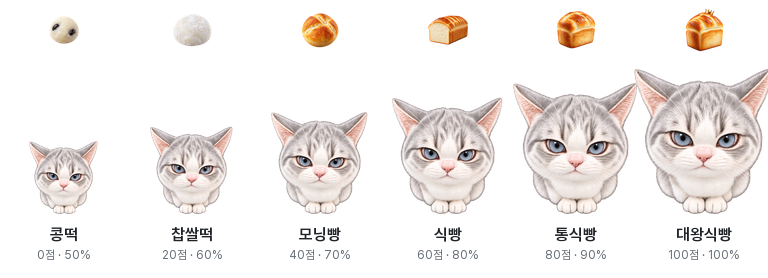
</picture>

**벌칙은 없습니다.** 1Key 가 켜져 있는 동안 지금 테마의 고양이만 10분에 1점씩 줄지만 콩떡보다 작아지지 않고, 꺼져 있거나 PC 가 잠든 시간은 세지 않습니다.

### 매일의 미션 — 보안 습관이 고양이 밥

| 할 일 | 점수 | 고양이 |
|---|---|---|
| 출근 도장: 그날 처음 잠금 풀기 | +5 (자동 잠금을 켜 두면 +5 더) | 앞발로 발도장 — "발도장 쾅! N일째 함께 출근" (주말은 건너뛰어도 연속) |
| 쉬는 시간: 50분 쉬지 않고 일한 뒤 5분 넘게 쉬기 | +5 | 기지개를 켜며 "52분 달렸어요, 잠깐 쉬어요!" → "잘 쉬었어요!" |
| 저장된 비밀번호 바꾸기 | +10 (하루 세 번까지) | "비밀번호를 새로 바꿨네요!" |
| 백업 파일 만들기 | +20 (일주일에 한 번) | "백업 고마워요!" |
| 마스터 비밀번호 바꾸기 | +20 (30일에 한 번) | "마스터 비밀번호 바꿨네요, 든든해요!" |

### 위젯 화면 — 상태 · 놀기 · 미션 · 앨범 · 이름

1Key 목록 아래 [위젯](트레이 위젯 모드를 켰을 때)이나 고양이 메뉴의 [수첩]을 누르면 고양이에 관한 것이 한 화면에 모여 있습니다 — 지금 단계 · 하트 · 점수, 쓰담 · 츄르 · 놀이 단추(누르면 작업 표시줄 고양이가 바로 반응), 오늘의 미션, 고양이가 처음 보여 준 장면을 모으는 앨범(13장), 흰 · 검은 고양이 이름.

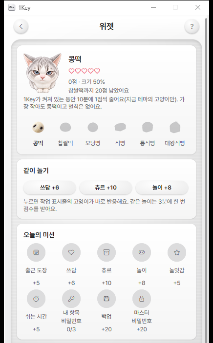

<picture>
  <source media="(prefers-color-scheme: dark)" srcset="docs/images/cat/album-dark.png">
  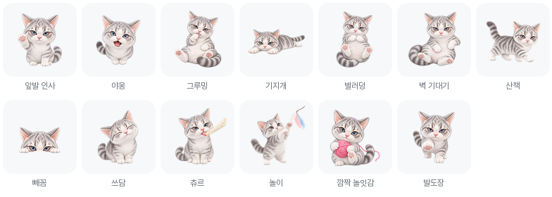
</picture>

### 흰 고양이와 검은 고양이

1Key 테마가 밝으면 흰 고양이, 어두우면 검은 고양이가 나옵니다("시스템 따름"이면 Windows 작업 표시줄 테마를 따름). 두 마리는 이름도 따로 짓고(위젯 화면), 점수도 따로 쌓여 따로 자랍니다. 테마를 바꿔 쉬고 있는 고양이는 점수가 줄지 않고 기다립니다.

## 🔑 1Key 기본 기능

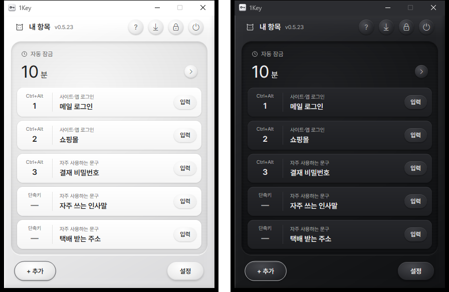

### 단축키 한 번으로 입력

- 내용(비밀번호·문장)을 99개까지 저장하고 항목마다 단축키를 지정합니다.
- 단축키를 누르면 지금 커서가 있는 칸에 입력합니다(특수문자·대소문자 그대로). 입력 방식은 5가지(자동 / 스캔코드 / 유니코드 / 창 메시지 / 클립보드) 중에서 고를 수 있어, 잘 안 먹히는 창에서도 방식을 바꿔 대응합니다.
- 단축키를 외우지 않은 항목은 목록의 [입력]을 누르고, 화면 위에 뜬 작은 입력 칩으로 넣을 칸을 골라 넣습니다.
- 웹사이트·윈도우 프로그램의 입력칸에 항목을 연결하면 아이디와 비밀번호를 한 번에 채웁니다.
- 자주 여는 프로그램 · 폴더 · 웹사이트를 목록 위에 모아 두고 바로 엽니다.
- 순수 Win32(C#, NativeAOT)로 만들어 런타임 설치 없이 exe 하나로 동작합니다.

### 마스터 비밀번호로 잠금

모든 내용은 마스터 비밀번호(Argon2id)로 잠깁니다. 자동 잠금, 백업·복원을 지원합니다.
잠긴 동안에는 작은 잠금 위젯이 뜨고, 비밀번호를 넣으려고 칸을 누르면 고양이가 "냐옹" 합니다. 입력하는 동안에는 가끔 천천히 눈을 깜빡이거나 작게 메롱 하고, 마스터 비밀번호가 틀리면 귀를 내렸다 올립니다.

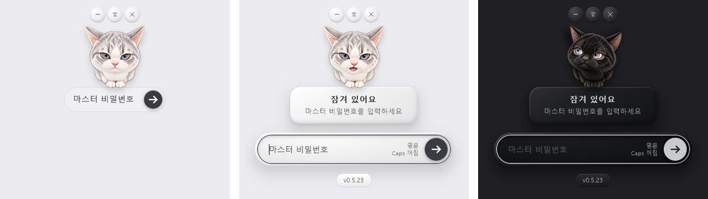

### 설정

설정은 한 화면에 모여 있고, 바꾼 내용은 [저장]을 눌러야 적용됩니다. Windows 시작 시 자동 실행, 테마(시스템 / 밝게 / 어둡게), 언어(한국어 · English · 简体中文 · 日本語 · Tiếng Việt), 자동 잠금, 입력 전송 키, 고양이 이름 등을 고릅니다.

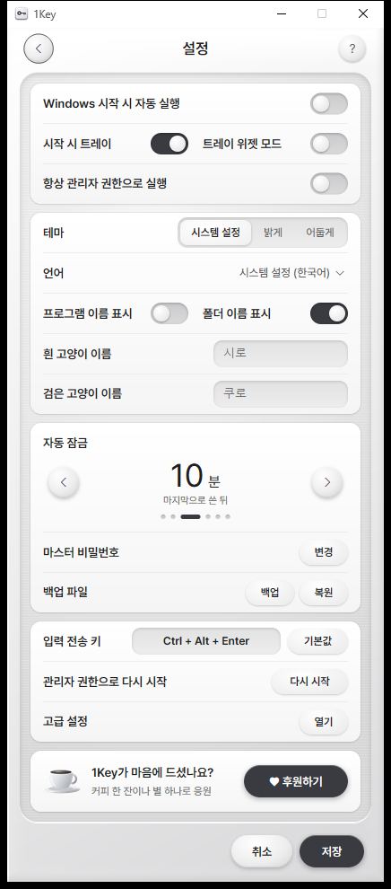

## 빌드

준비(한 번만): .NET 8 SDK, Visual Studio 2022 Build Tools("C++ 데스크톱 개발" + Windows 11 SDK). 설치 파일까지 만들려면 NSIS.

```
powershell -ExecutionPolicy Bypass -File build-aot.ps1
```

결과물: `build\<버전>\1Key.exe` 와 `build\<버전>\1Key-Setup-<버전>.exe`.

## 폴더

- `src/OneKey` — 프로그램 소스. 그림 자원은 `Assets/cat`, 글꼴은 `Fonts`(Pretendard, OFL 1.1 — `Fonts/OFL-Pretendard.txt`)
- `installer` — NSIS 설치 스크립트
- `tools/tests` — 창을 띄워 실제로 눌러 보는 시험 스크립트(시험용 설정 폴더만 씀: `ONEKEY_TEST=1`, `ONEKEY_CONFIG_DIR`, `ONEKEY_INSTANCE_SUFFIX`)
- `tools/i18n` — `src/OneKey/i18n/strings.tsv` 로 문구 코드를 만드는 생성기
- `tools/readme-shots.ps1` — 이 README 의 스크린샷을 예시 항목으로 다시 찍는 스크립트(`docs/images`)
- `tools/readme-cat.py` — README 의 고양이 움직이는 그림 · 성장 단계 · 앨범 그림을 앱의 그림 자원으로 다시 만드는 스크립트(`docs/images/cat`, Python + Pillow)

## 알림

- 마스코트 고양이 그림은 AI(Codex)로 만든 그림입니다.
- 스크린샷의 항목과 값은 모두 예시입니다.
- 코드 서명이 없는 exe 라 처음 실행할 때 SmartScreen 경고가 나올 수 있습니다.

## 라이선스

[MIT](LICENSE). 함께 들어 있는 Pretendard 글꼴은 SIL Open Font License 1.1(`src/OneKey/Fonts/OFL-Pretendard.txt`)을 따릅니다.
